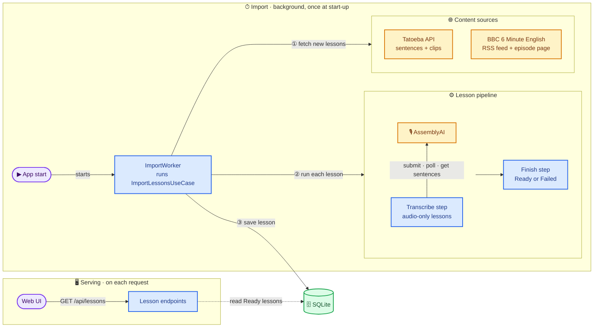

# Dictation Practice

A small personal web app for practising English listening by dictation: listen to one sentence, write down what
you hear, check against the transcript, move on.

It needs real audio already cut into timed sentences, so a background import pulls content from public sources and
turns it into **lessons**: an ordered list of **segments**, each with its text and its own audio range. The web UI
lists lessons and plays them sentence by sentence (play, replay, previous, next, show transcript).

English only for now; language is carried as data so other languages can be added later.

> **Personal, non-commercial use only.** BBC terms allow personal use and most Tatoeba audio is CC BY-NC-ND, so the
> app streams audio from its original location and never re-hosts or redistributes it.
>
> For the same reason it is single-user and runs on `localhost` only, so **authentication and authorization were
> intentionally skipped**: every endpoint is open. Don't expose it on a network or host it publicly.

## How it works

The app runs two independent processes that share nothing but the database: a background **import** that writes
lessons, and the **serving** path that reads them when the UI asks. Neither waits for or triggers the other.



**Import:**

1. On start-up `ImportWorker` runs the import once per content source, in parallel.
2. Each source returns up to `Import:MaxPerSource` new lessons per language, skipping anything already stored.
3. Each lesson goes through the pipeline. Lessons that only have one long audio file (BBC) are transcribed into
   timed sentences, then every lesson ends as `Ready` (has segments) or `Failed`.
4. Lessons are stored with their status. A stored lesson is never imported again, so re-runs add no duplicates and a
   `Failed` lesson is not retried.

**Serving:** the UI calls the lesson endpoints, which read only `Ready` lessons from SQLite. The UI works while an
import is still running; lessons simply appear as they are saved.

A source that fails (network, bad response) is logged and skipped for that run; it never stops the app or the
other sources.

### Content sources

| Source | What we read | What becomes a lesson | Docs |
|---|---|---|---|
| **Tatoeba** (`tatoeba`) | `GET /v1/sentences` (JSON, paged) for English sentences that have audio, newest first | A group of `GroupSize` sentences (default 10), one segment per sentence, each playing its own short clip `/v1/audios/{id}/file` | [OpenAPI spec](https://api.tatoeba.org/openapi.json), [notes](_bmad-output/research-audio-sources-and-transcription-integrat/digests/sources-tatoeba.md) |
| **BBC 6 Minute English** (`bbc`) | The podcast RSS feed (XML), then each episode's web page to find its `…_download.mp3` link | One episode, one long audio file, no segments until it is transcribed | [Series page](https://www.bbc.co.uk/learningenglish/english/features/6-minute-english), [feed](https://podcasts.files.bbci.co.uk/p02pc9tn.rss), [notes](_bmad-output/research-audio-sources-and-transcription-integrat/digests/sources-bbc.md) |

Duplicates are detected with keys stored per source: the lesson's `ExternalId` (Tatoeba: the sentence ids of the
group, BBC: the feed item's `guid`) and each segment's `ExternalKey` (Tatoeba: `sentenceId:audioId`).

The BBC source is only enabled when an AssemblyAI API key is configured, because its episodes cannot become lessons
without transcription. Without a key the app logs a warning at start-up and imports Tatoeba only.

### Transcription

| Provider | Flow | Docs |
|---|---|---|
| **AssemblyAI** (`assemblyai`) | `POST /v2/transcript` with the episode's audio URL → poll `GET /v2/transcript/{id}` until `completed` → `GET /v2/transcript/{id}/sentences` | [Submit](https://www.assemblyai.com/docs/api-reference/transcripts/submit), [Get sentences](https://www.assemblyai.com/docs/api-reference/transcripts/get-sentences), [notes](_bmad-output/research-audio-sources-and-transcription-integrat/digests/transcription-apis.md) |

Each returned sentence becomes a segment with its text, `startMs` and `endMs` within the episode audio (overlaps are
clamped). The provider sits behind `ITranscriptionProvider`, so another one can be plugged in with a new adapter and
a DI registration.

AssemblyAI is a paid service: every submitted episode is billed. The failed submit request is never retried
automatically, so a network error does not create a second job.

## Run locally

### Prerequisites

- [.NET 10 SDK](https://dotnet.microsoft.com/download/dotnet/10.0)
- Optional: an [AssemblyAI API key](https://www.assemblyai.com/dashboard) to import BBC episodes

### 1. Configure (optional)

Put local secrets in `src/Dictation.Api/appsettings.Local.json`. The file is gitignored and loaded on top of
`appsettings.json`:

```json
{
  "Transcription": {
    "AssemblyAi": {
      "ApiKey": "<your AssemblyAI key>"
    }
  }
}
```

Useful settings in [appsettings.json](src/Dictation.Api/appsettings.json):

| Setting | Default | Meaning |
|---|---|---|
| `Import:Enabled` | `true` | Run the import at start-up |
| `Import:Languages` | `["en"]` | Languages to import |
| `Import:MaxPerSource` | `5` | New lessons per source and language per run |
| `Sources:Tatoeba:GroupSize` | `10` | Sentences per Tatoeba lesson |
| `Transcription:AssemblyAi:PollIntervalSeconds` | `5` | Seconds between job status checks |
| `ConnectionStrings:Dictation` | `Data Source=dictation.db` | SQLite file |

### 2. Run

```bash
dotnet run --project src/Dictation.Api
```

Open <http://localhost:5080>. On start-up the database is created and migrated, and the import runs in the background.
Tatoeba lessons appear within seconds; BBC lessons appear when their transcription finishes. Refresh the page to see
them.

The database is `src/Dictation.Api/dictation.db` (`dotnet run` starts the app in its project folder). To start over,
stop the app and delete `src/Dictation.Api/dictation.db*`.

### API

| Endpoint | Returns |
|---|---|
| `GET /api/lessons?page=1&pageSize=20` | A page of `Ready` lessons, newest first, with `totalCount` (`pageSize` max 100) |
| `GET /api/lessons/{id}` | One `Ready` lesson with its segments in order, or `404` |

JSON is camelCase with null fields omitted; errors are `application/problem+json`. The full contract is in
[web-contract.md](_bmad-output/architecture-dictation-practice/web-contract.md).

## Repository structure

The backend follows a clean-architecture split: dependencies point inwards (`Api → Infrastructure → Application →
Domain`).

```
Dictation.slnx
src/
├── Dictation.Domain/              Lesson and Segment entities, LessonStatus. No dependencies.
├── Dictation.Application/
│   ├── Common/Pipelines/          Generic step pipeline (IPipelineStep, Pipeline)
│   ├── Import/                    ImportLessonsUseCase, the lesson pipeline and its steps,
│   │   └── Abstractions/          and the ports: IContentSource, ITranscriptionProvider, ILessonImportRepository
│   └── Lessons/                   Read side: GetLessons / GetLesson queries (MediatR) and ILessonRepository
├── Dictation.Infrastructure/
│   ├── ContentSources/Bbc/        BBC adapter (RSS + episode page)
│   ├── ContentSources/Tatoeba/    Tatoeba adapter
│   ├── Transcription/AssemblyAi/  AssemblyAI adapter
│   └── Persistence/               EF Core + SQLite: DictationDbContext, LessonRepository, Migrations/
└── Dictation.Api/
    ├── Program.cs                 Host, DI and middleware setup; migrates the database on start-up
    ├── ImportWorker.cs            Background service that runs the import once per source
    ├── Endpoints/                 Minimal API lesson endpoints
    └── wwwroot/                   Static web UI: index.html (lesson list), practice.html (player)
tests/
├── Dictation.Tests/               Unit tests
└── Dictation.IntegrationTests/    Integration tests
_bmad-output/                      Spec, architecture, and research notes on the sources and transcription APIs
```

Each external system is one adapter in `Infrastructure` behind a port in `Application/Import/Abstractions`. To add a
source, implement `IContentSource` and register it in
[LessonResourcesServiceCollectionExtensions.cs](src/Dictation.Api/LessonResourcesServiceCollectionExtensions.cs).

## Tests

```bash
dotnet test Dictation.slnx                  # everything
dotnet test tests/Dictation.Tests           # unit tests only (fast)
```

## Database changes

The schema is managed with EF Core migrations and applied automatically at start-up. After changing the model, add a
migration:

```bash
dotnet tool install --global dotnet-ef   # once
dotnet ef migrations add <Name> --project src/Dictation.Infrastructure --startup-project src/Dictation.Api
```

## Further reading

- [Spec](_bmad-output/spec-dictation-practice/spec-dictation-practice.md): what the app must do and why
- [Architecture](_bmad-output/architecture-dictation-practice/architecture-dictation-practice.md) and
  [adapter rules](_bmad-output/architecture-dictation-practice/adapter-rules.md)
- [Research on sources and transcription APIs](_bmad-output/research-audio-sources-and-transcription-integrat/research-audio-sources-and-transcription-integrat.md)
