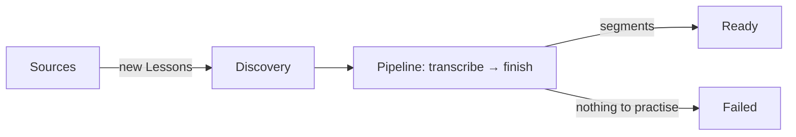

# Architecture Spine — Dictation Practice

Per-adapter details are in [adapter-rules.md](adapter-rules.md). The REST endpoints and player behaviour are in [web-contract.md](web-contract.md).

## Design Paradigm

**Clean Architecture, kept small.** Four layers (Domain, Application, Infrastructure, Api) with dependencies pointing inward. `Application` defines the interfaces it needs (`IContentSource`, `ITranscriptionProvider`, `ILessonRepository`). Each external API gets one **adapter** in `Infrastructure` (Adapter pattern) that implements the interface and translates that API's DTOs to domain types. Use cases are plain services; no MediatR or CQRS.

| Project | Holds |
| --- | --- |
| `Dictation.Domain` | `Lesson`, `Segment`, `LessonStatus`; no package references |
| `Dictation.Application` | `Pipeline<T>` and `IPipelineStep<T>`; import (`ImportRunner`, `DiscoveryService`, `TranscribeStep`, `FinishStep`); `LessonQueryService`; interfaces for adapters and the repository; `ProviderException`; options |
| `Dictation.Infrastructure` | Source and transcription adapters with their `internal` DTOs; EF Core `DbContext` and repository |
| `Dictation.Api` | `Program.cs`, Minimal API endpoints, `ImportBackgroundService`, `wwwroot` UI |
| `Dictation.Tests` | Unit, adapter (recorded responses) and API integration tests |

**Import flow:**



## Rules

### AD-1 — Dependencies point inward; things plug in

- `Domain` references nothing. `Application` references only `Domain` and `Microsoft.Extensions.*.Abstractions`. `Infrastructure` references only `Application`. Adapters never reference each other or the repository. Project references enforce this.
- Sources, providers and steps have constant lowercase keys (`bbc`, `tatoeba`, `assemblyai`, `gladia`, `transcribe`, `finish`), not enums.
- Add a source = adapter + DI registration + config + fixtures. Add a step = step + DI registration + one `Import:Pipeline:Steps` entry.

### AD-2 — Sources return `Lesson`s

- `IContentSource.DiscoverAsync(language, knownKeys, max, ct)` returns up to `Import:MaxPerSource` (5) **new** `Lesson`s. Known keys are passed so sources skip what is already stored.
- Each adapter maps its own `internal` DTOs to a lesson with `Lesson.CreateDiscovered(...)` and `AddSegment(...)`, filling in whatever its source has (BBC: `SourceAudioUrl`; Tatoeba: segments).
- One segment shape for every source: `Segment { Index, ExternalKey?, Text, AudioUrl, StartMs, EndMs? }`. `Index` is 0-based and assigned by `Lesson`. One sentence = one segment. `EndMs` is exclusive; `null` means play to the end of the clip.
- Unique indexes on `(Source, ExternalId)` and `(Source, Segment.ExternalKey)`. A violation skips that lesson without failing the run.
- `Lesson.Language` stores `en`. `DiscoveryService` iterates `Import:Languages` ∩ each source's `SupportedLanguages`; adapters map to their own codes.

### AD-3 — Import is discovery, then a pipeline of steps

- The pipeline is generic and knows nothing about lessons:

  ```csharp
  public interface IPipelineStep<T>
  {
      string Name { get; }
      /// <summary>Data-driven guard: skip this step when its work isn't needed for this item.</summary>
      bool AppliesTo(T item);
      Task<T> RunAsync(T item, CancellationToken ct);
  }
  ```

  `Pipeline<T>` runs steps in order, skips those whose `AppliesTo` is false, and calls an after-step callback (`Func<T, CancellationToken, Task>`); the lesson host passes "save the lesson".
- `AppliesTo` is pure: it reads only the item's own data, never `Source`, and does no I/O.
- Steps run in the order of `Import:Pipeline:Steps` (default `["transcribe", "finish"]`). An unknown name fails startup; `finish` is last.

  | Step | Applies when (not `Ready`/`Failed`, and…) | Does |
  | --- | --- | --- |
  | `transcribe` | `SourceAudioUrl` set, no segments | No job id: submit (if under the concurrency cap). Job id: poll; on completion add the segments. |
  | `finish` | has segments, or has no `SourceAudioUrl` | Segments → `Complete()` (`Ready`). None → `Fail()`. |

- An unfinished lesson simply runs again next tick, so restart needs no resume code: a stored job id is polled, never resubmitted.
- `ImportBackgroundService` (only when `Import:Enabled`) calls `ImportRunner.DiscoverAsync` once per app start, then `TickAsync` every 10 s while work remains, with a new DI scope per lesson. All logic lives in `Application`.

### AD-4 — Lessons change only through `Lesson` methods

- `CreateDiscovered` (sources), `StartTranscription`, `Complete`, `Fail` (steps). `Complete()` requires at least one segment.
- Only `Ready` matters to the outside: it is the only status the API exposes, and `Ready`/`Failed` are never processed again. `Discovered`/`Transcribing` are kept for data consistency; no guard depends on them.
- Saves: discovery saves each new lesson once; the pipeline saves after each executed step.

### AD-5 — Failures: retry within one run, then permanently failed

| `FailureKind` | Triggers | Effect |
| --- | --- | --- |
| `Transient` | timeout, network, 408, 429, 5xx, open circuit, quota rejection | Change not saved; retried next tick within this run. |
| `Permanent` | provider error, empty transcript, 400/422 | `Fail()`. |
| `Configuration` | 401/403, missing key or config | That step is disabled for the run; lessons untouched. |

- Adapters throw only `ProviderException(FailureKind, message)`. Any other exception from a step is logged and treated as `Transient`; none escapes one lesson.
- `Failed` is permanent; the detail is logged, not stored.
- Limits: transcription 30 min (step polls first), transient errors `Import:MaxPendingMinutes` (30), run `Import:MaxRunMinutes` (60). Past a limit the lesson is `Failed`.
- Submit is never auto-retried (`Retry.DisableForUnsafeHttpMethods()`).

### AD-6 — One transcription provider

- Only `AssemblyAiTranscriptionProvider` is registered; `TranscribeStep` takes it by constructor. `GladiaTranscriptionProvider` is an unregistered placeholder with a `Transcription:Gladia` config section, for demonstration.
- At submit the lesson stores the provider key and job id. If a stored key doesn't match the registered provider, the step throws `Configuration`.
- Submit only while open jobs < `MaxConcurrentJobs` (AssemblyAI 5).

### AD-7 — Audio is a URL only

- Only audio URLs are stored. No code requests an audio URL during import or stores audio bytes, server-side or in the browser. Providers fetch the URL themselves; no upload endpoints.
- The URL sent to transcription is the URL every segment plays (BBC `_download.mp3`, never the RSS enclosure).

### AD-8 — The UI is a REST client only

- `wwwroot` calls only the endpoints in [web-contract.md](web-contract.md); only `Ready` lessons are exposed.
- Lesson detail carries no text; text comes only from `/transcript`.

### AD-9 — Tests never touch live providers

- Adapters are tested against recorded responses in `Fixtures/{provider}/`, with no keys. A shared transcription contract test (non-empty trimmed text, integer ms, ordered, non-overlapping) runs for AssemblyAI.
- `Pipeline<T>`, each step, `DiscoveryService` and `ImportRunner` are unit-tested with stubs, including one "fits every source" test: a lesson with segments skips `transcribe` and ends `Ready`; one with no audio and no segments ends `Failed`.
- API tests use `Import:Enabled=false` and a temporary SQLite file.

## Conventions

| Concern | Convention |
| --- | --- |
| Naming | `{Provider}{Role}` adapters, `{Work}Step` steps, `I`-prefixed interfaces, `internal` `{Provider}…Dto` |
| Data | Integer ms; UTC via `TimeProvider`; `Guid` ids; camelCase JSON, nulls omitted; enums persisted by name |
| Errors | `ProblemDetails` for every HTTP error (detail in Development only) |
| Logging | Structured; import logs carry `LessonId`, `Source`, `Stage` (step name or `discovery`); never headers or keys |
| Config | Typed options under `Sources:*`, `Transcription:*`, `Import:*`; keys in gitignored `appsettings.Local.json` |
| Code | `async` I/O with `CancellationToken`; typed `HttpClient`s with the standard resilience handler; Kestrel on `localhost` |
| Startup | `MigrateAsync()` before `app.Run()`, never `EnsureCreated`; SQLite in WAL mode |

## Stack

| Name | Version |
| --- | --- |
| .NET / ASP.NET Core (LTS) | 10.0.13 |
| Microsoft.EntityFrameworkCore.Sqlite | 10.0.13 |
| Microsoft.Extensions.Http.Resilience | 10.11.0 |
| xunit.v3 | 4.0.2 |
| Microsoft.AspNetCore.Mvc.Testing | 10.0.13 |
| UI | static HTML + vanilla JS |

## Structural Seed

`Lesson { Id, Source, ExternalId, Title, Language, SourceUrl, SourceAudioUrl?, Status, TranscriptionProvider?, TranscriptionJobId?, TranscriptionStartedAt?, CreatedAt }` owns `Segment`s (AD-2).

```text
src/Dictation.Domain/          # Lessons/
src/Dictation.Application/     # Pipelines/; Import/ (ImportRunner, DiscoveryService, Steps/, interfaces, options); Lessons/
src/Dictation.Infrastructure/  # Sources/*, Transcription/* (AssemblyAi, Gladia placeholder), Persistence/
src/Dictation.Api/             # Program.cs, Endpoints/, ImportBackgroundService, wwwroot/
tests/Dictation.Tests/         # Domain/, Application/, Persistence/, Adapters/ + Fixtures/, Api/
```

Runs locally only (`dotnet run --project src/Dictation.Api`); the SQLite file is gitignored.

## Deferred

- Retrying failed lessons; a separate Worker host (only the host changes); implementing Gladia.
- Webhooks; Docker, cloud, CI; auth; metrics and tracing; non-English sources.
- Re-check provider API formats before the adapter stories if past 2026-11-22.
