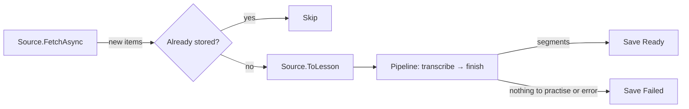

# Architecture Spine — Dictation Practice

Per-adapter details are in [adapter-rules.md](adapter-rules.md). The REST endpoints and player behaviour are in [web-contract.md](web-contract.md).

## Design Paradigm

**Clean Architecture, kept small.** Four layers (Domain, Application, Infrastructure, Api) with dependencies pointing inward. `Application` defines the interfaces it needs (`IContentSource`, `ITranscriptionProvider`, `ILessonImportRepository`). Each external API gets one **adapter** in `Infrastructure` (Adapter pattern) that implements the interface and translates that API's DTOs to domain types. The import use case is a plain service. Reads use the **Mediator** pattern: an endpoint sends a query through MediatR's `ISender`, which forwards it to its handler.

| Project | Holds |
| --- | --- |
| `Dictation.Domain` | `Lesson`, `Segment`, `LessonStatus`; no package references |
| `Dictation.Application` | One folder per use case. `Import/`: `ImportLessonsUseCase`, `LessonPipeline`, `Steps/`, `Abstractions/` (interfaces for adapters and the repository), `Configurations/` (options), `ImportException`. `Lessons/`: the lesson queries and their result records. Shared: `Pipelines/` (`Pipeline<T>`, `IPipelineStep<T>`) |
| `Dictation.Infrastructure` | Source and transcription adapters with their `internal` DTOs; `DictationDbContext` (EF Core mapping and migrations; it also implements `ILessonImportRepository`); `LessonQueryHandlers` |
| `Dictation.Api` | `Program.cs`, Minimal API endpoints, `ImportWorker`, `wwwroot` UI |
| `Dictation.Tests` | Unit tests of our own behaviour: domain, pipeline and use case with fakes |

**Built:** the Tatoeba and BBC imports end to end, with AssemblyAI transcription, and the REST endpoints. **Planned:** the Gladia placeholder and the UI.

**Import flow:**



## Rules

### AD-1 — Dependencies point inward; things plug in

- `Domain` references nothing. `Application` references only `Domain`, `Microsoft.Extensions.*.Abstractions` and `MediatR.Contracts`. `Infrastructure` references only `Application`. Adapters never reference each other or the repository. Project references enforce this.
- Sources and providers have constant lowercase keys (`bbc`, `tatoeba`, `assemblyai`, `gladia`), not enums.
- Add a source = adapter + DI registration + config. Add a step = step + one line in `LessonPipeline.ConfigureSteps`.

### AD-2 — Sources fetch items; adapters map them to `Lesson`s

- `IContentSource.FetchAsync(language, knownKeys, max, ct)` returns up to `Import:MaxPerSource` (5) **new** items, each a `SourceItem(ExternalId)` subtype private to the adapter. Known keys are passed so sources skip sentences already stored.
- `IContentSource.ToLesson(item)` maps one item to a `Discovered` lesson with `Lesson.CreateDiscovered(...)` and `AddSegment(...)`, filling in whatever its source has (BBC: `SourceAudioUrl`; Tatoeba: segments).
- One segment shape for every source: `Segment { Index, ExternalKey?, Text, AudioUrl, StartMs, EndMs? }`. `Index` is 0-based and assigned by `Lesson`. One sentence = one segment. `EndMs` is exclusive; `null` means play to the end of the clip.
- Unique indexes on `(Source, ExternalId)` and `(Source, Segment.ExternalKey)`. A violation skips that lesson without failing the run.
- `Lesson.Language` stores `en`. `ImportLessonsUseCase` iterates `Import:Languages` ∩ each source's `SupportedLanguages`; adapters map to their own codes.

### AD-3 — Import runs each item through a pipeline of steps

- The pipeline is generic and knows nothing about lessons:

  ```csharp
  public interface IPipelineStep<T>
  {
      /// <summary>Data-driven guard: skip this step when its work isn't needed for this item.</summary>
      bool AppliesTo(T item);
      Task<T> RunAsync(T item, CancellationToken ct);
  }
  ```

  `Pipeline<T>` is an abstract base that runs steps in memory, in order, skipping those whose `AppliesTo` is false. Nothing is saved until it returns.
- `AppliesTo` is pure: it reads only the item's own data, never `Source`, and does no I/O.
- Steps are not registered in DI. Each derived pipeline lists its own steps in run order in `ConfigureSteps`. `LessonPipeline` adds `TranscribeStep`, then `FinishStep`; it takes any dependency its steps need by constructor.

  | Step | Applies when (not `Ready`/`Failed`, and…) | Does |
  | --- | --- | --- |
  | `TranscribeStep` | `SourceAudioUrl` set, no segments | Submits the audio, polls until the transcript is ready, then adds the segments. |
  | `FinishStep` | always | Segments → `Complete()` (`Ready`). None → `Fail()`. |

- `ImportLessonsUseCase.ExecuteAsync(source, ct)` holds the whole import business for one source. It fetches the new items, then for each one: skip it if a lesson with its `ExternalId` is already stored (`Ready` or `Failed`); otherwise `ToLesson`, run the pipeline, and save the result once. Re-runs are idempotent.
- `ImportWorker` (a hosted service, only when `Import:Enabled`) runs the use case once per registered `IContentSource` at app start, in parallel, each in its own DI scope. It holds no business logic.

### AD-4 — Lessons change only through `Lesson` methods

- `CreateDiscovered` (sources), `StartTranscription`, `Complete`, `Fail` (steps). `Complete()` requires at least one segment.
- Only `Ready` matters to the outside: it is the only status the API exposes, and `Ready`/`Failed` are never processed again. `Discovered`/`Transcribing` are kept for data consistency; no guard depends on them.
- Saves: each lesson is saved once, after its pipeline run, as `Ready` or `Failed`.

### AD-5 — Any failure is final

- Any exception while importing an item marks its lesson `Failed` and saves it, so the exists check skips it from then on. Only identifiers are logged, never payload content; no exception escapes one item.
- Any exception while fetching skips that source for the run, with a log entry.
- One exception type, `ImportException(message)`: adapters throw it for problems the provider signals (error status, empty transcript), and `Pipeline<T>` wraps any step error in it, naming the step type in the message.
- HTTP calls use the standard resilience handler, which retries inside the call. Submit is never auto-retried (`Retry.DisableForUnsafeHttpMethods()`).

### AD-6 — One transcription provider

- Only `AssemblyAiTranscriptionProvider` is registered; `TranscribeStep` takes it by constructor. `GladiaTranscriptionProvider` is an unregistered placeholder with a `Transcription:Gladia` config section, for demonstration.
- `TranscribeStep` submits the audio, records the provider key and job id with `StartTranscription`, asks the provider for the sentences (the AssemblyAI adapter polls every `Transcription:AssemblyAi:PollIntervalSeconds`, default 5, until the job is done), then adds one segment per sentence. A job still polling when the app stops is lost; the next start submits the episode again.
- Episodes are imported one at a time, so at most one job is open (AssemblyAI allows 5).
- Without `Transcription:AssemblyAi:ApiKey`, the BBC source is not registered, so no episode fails for a missing key.

### AD-7 — Audio is a URL only

- Only audio URLs are stored. No code requests an audio URL during import or stores audio bytes, server-side or in the browser. Providers fetch the URL themselves; no upload endpoints.
- The URL sent to transcription is the URL every segment plays (BBC `_download.mp3`, never the RSS enclosure).

### AD-8 — The UI is a REST client only

- `wwwroot` calls only the endpoints in [web-contract.md](web-contract.md); only `Ready` lessons are exposed.
- Lesson detail includes each segment's text; the UI keeps it hidden until the transcript button is pressed.
- Each endpoint sends one query (`GetLessonsQuery`, `GetLessonQuery`) through `ISender`. The queries and result records live in `Application/Lessons`; `LessonQueryHandlers` in Infrastructure answers them from `DictationDbContext` with `AsNoTracking()`, filtered to `Ready`. Endpoints only validate input and map a null result to 404.

### AD-9 — Unit tests of our behaviour only

- For now the suite is unit tests only: no API host, no database, no network. Integration tests come later.

- Adapters (sources, transcription) are not unit tested; they are checked by running the app against the real services.
- Tests cover the happy path and that any error, whatever its kind, fails the lesson and later runs skip it.
- The domain, `Pipeline<T>`, each step and `ImportLessonsUseCase` are tested with in-memory fakes, including one "fits every source" test: a lesson with segments skips `TranscribeStep` and ends `Ready`; one with no audio and no segments ends `Failed`.

## Conventions

| Concern | Convention |
| --- | --- |
| Naming | `{Provider}{Role}` adapters, `{Work}Step` steps, `I`-prefixed interfaces, `internal` `{Provider}…Dto` |
| Data | Integer ms; UTC `DateTime`; `Guid` ids; camelCase JSON, nulls omitted; enums persisted by name |
| Errors | `ProblemDetails` for every HTTP error (detail in Development only) |
| Logging | Structured; import logs carry `LessonId` and `Source`; never headers or keys |
| Config | Typed options under `Sources:*`, `Transcription:*`, `Import:*`; keys in gitignored `appsettings.Local.json` |
| Code | `async` I/O with `CancellationToken`; typed `HttpClient`s with the standard resilience handler; Kestrel on `localhost` |
| Startup | `MigrateAsync()` before `app.Run()`, never `EnsureCreated`; SQLite in WAL mode |

## Stack

| Name | Version |
| --- | --- |
| .NET / ASP.NET Core (LTS) | 10.0.13 |
| Microsoft.EntityFrameworkCore.Sqlite | 10.0.13 |
| Microsoft.Extensions.Http.Resilience | 10.11.0 |
| MediatR (last Apache-2.0 release; 13+ needs a licence key) | 12.5.0 |
| xunit.v3 | 4.0.2 |
| Microsoft.AspNetCore.Mvc.Testing | 10.0.13 |
| UI | static HTML + vanilla JS |

## Structural Seed

`Lesson { Id, Source, ExternalId, Title, Language, SourceUrl, SourceAudioUrl?, Status, TranscriptionProvider?, TranscriptionJobId?, TranscriptionStartedAt?, CreatedAt }` owns `Segment`s (AD-2).

```text
src/Dictation.Domain/          # Lessons/
src/Dictation.Application/     # Import/ (ImportLessonsUseCase, LessonPipeline, Steps/, Abstractions/, Configurations/); Lessons/ (queries); Pipelines/ (shared)
src/Dictation.Infrastructure/  # ContentSources/*, Transcription/* (AssemblyAi, Gladia placeholder), Persistence/
src/Dictation.Api/             # Program.cs, Endpoints/, ImportWorker, wwwroot/
tests/Dictation.Tests/         # Domain/, Application/, Support/ (fakes)
```

Runs locally only (`dotnet run --project src/Dictation.Api`); the SQLite file is gitignored.

## Deferred

- Retrying failed lessons; a separate Worker host (only the host changes); implementing Gladia.
- Webhooks; Docker, cloud, CI; auth; metrics and tracing; non-English sources.
- Re-check provider API formats before the adapter stories if past 2026-11-22.
