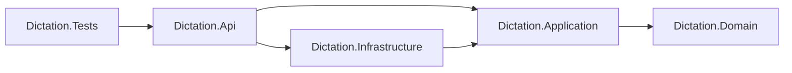
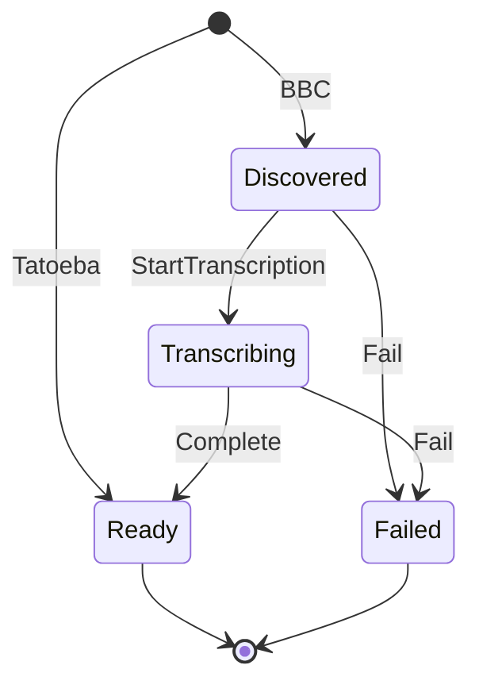
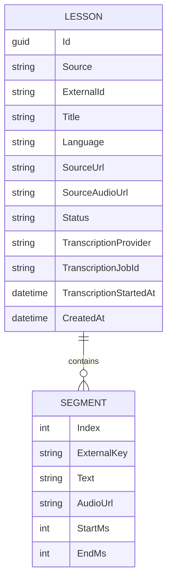

# Architecture Spine — Dictation Practice

Per-adapter details are in [adapter-rules.md](adapter-rules.md). The REST endpoints and player behaviour are in [web-contract.md](web-contract.md).

## Design Paradigm

**Ports & Adapters with Domain and Application layers (Clean Architecture style), kept small.** Use cases are plain services; there is no MediatR or CQRS framework.

| Project | Holds |
| --- | --- |
| `Dictation.Domain` | `Lesson`, `Segment`, `LessonStatus` and their rules; no package references |
| `Dictation.Application` | Use cases (`ImportService`, `LessonQueryService`), ports (`IContentSource`, `ITranscriptionProvider`, repository), `ProviderException`, options |
| `Dictation.Infrastructure` | BBC, Tatoeba, AssemblyAI and Gladia adapters; EF Core `DbContext` and repository; provider DTOs |
| `Dictation.Api` | `Program.cs`, Minimal API endpoints, `ImportBackgroundService`, `wwwroot` UI |
| `Dictation.Tests` | Domain and Application unit, adapter (recorded responses), API integration |



## Invariants & Rules

### AD-1 — Dependencies point inward; providers plug in

- **Binds:** all
- **Prevents:** domain code depending on EF or HTTP; adding a provider requiring edits to `Domain` or `Application`.
- **Rule:**
  - `Domain` references nothing. `Application` references only `Domain` and `Microsoft.Extensions.*.Abstractions`. `Infrastructure` references only `Application` (and through it `Domain`). Adapters never reference each other or the repository. The project references enforce this.
  - Sources and transcription providers are identified by lowercase string keys (`bbc`, `tatoeba`, `assemblyai`, `gladia`), not enums.
  - `ImportService` uses every registered `IContentSource`, and resolves `ITranscriptionProvider` by key.
  - Adding a provider = adapter + DI registration + config + fixtures.

### AD-2 — Ports and drafts

- **Binds:** CAP-1, CAP-2
- **Prevents:** provider shapes leaking into `Domain` or `Application`; sources returning incompatible drafts.
- **Rule:**
  - `IContentSource.DiscoverAsync(language, knownKeys, max)` returns `LessonDraft`s of exactly two kinds:
    - **transcribable** (BBC): `SourceAudioUrl` set, no sentences;
    - **ready** (Tatoeba): `DraftSentence { ExternalKey, Text, AudioUrl }` list, no `SourceAudioUrl`.
  - `ITranscriptionProvider` exposes `SubmitAsync(audioUrl, language)`, `GetStatusAsync(jobId)` → `Pending | Completed`, and `GetSentencesAsync(jobId)` → ordered `TranscribedSentence { Text, StartMs, EndMs }`, plus `MaxConcurrentJobs`.
  - Adapters throw only `ProviderException(FailureKind, message)`. A provider `error` status is thrown, never returned.

### AD-3 — One segment shape for every source

- **Binds:** CAP-1, CAP-5
- **Prevents:** the player branching on source; index clashes; sentences split or merged.
- **Rule:**
  - `Segment { Index, ExternalKey?, Text, AudioUrl, StartMs, EndMs? }`.
  - `Index` is 0-based and assigned only by `Lesson`.
  - One sentence = one segment; nothing splits or merges sentences.
  - BBC: every segment uses the lesson's audio URL with its own `StartMs` and `EndMs`. Tatoeba: own clip, `StartMs = 0`, `EndMs = null` (play to end).
  - `EndMs` is exclusive; segments are ordered and non-overlapping.

### AD-4 — Lesson lifecycle has one owner

- **Binds:** CAP-1, CAP-3
- **Prevents:** two code paths changing `Status`; half-written lessons becoming visible.
- **Rule:**
  - `Status` changes only through `Lesson` methods (`CreateDiscovered`, `CreateReady`, `StartTranscription`, `Complete`, `Fail`), called only by `ImportService`. `ImportService` saves once after each call.
  - Segments are an owned collection, written in the same save as the transition to `Ready`.
  - `SourceAudioUrl`, `TranscriptionProvider`, `TranscriptionJobId` and `TranscriptionStartedAt` are persisted.

### AD-5 — Failure handling: retry within one run, then permanently failed

- **Binds:** CAP-1, CAP-3
- **Prevents:** inconsistent retries; endless loops; double-billed submissions; lost transcripts.
- **Rule:**

  | `FailureKind` | Triggers | Effect |
  | --- | --- | --- |
  | `Transient` | timeout, network, 408, 429, 5xx, open circuit, quota rejection | Retried only within the current run (resilience handler + next tick). |
  | `Permanent` | no download link, provider error, empty transcript, 400/422 | `Fail()` at once. |
  | `Configuration` | 401/403, missing key or config | That stage and provider are disabled for the run; lessons are untouched. |

  - **`Failed` is permanent.** Never retried automatically. No reason is stored; the detail is logged.
  - **The run gives up on a lesson** when: transcription exceeds 30 min (always poll first); transient errors persist beyond `Import:MaxPendingMinutes` (30); or the `Import:MaxRunMinutes` (60) deadline is reached.
  - **A crash or stop is not a failure.** The next start resumes `Discovered` lessons (submit) and `Transcribing` lessons (poll the stored job, never resubmit).
  - **Submit is never retried within a tick:** `Retry.DisableForUnsafeHttpMethods()`.

### AD-6 — Idempotent import

- **Binds:** CAP-1
- **Prevents:** duplicate lessons or sentences; BBC stalling after the first run.
- **Rule:**
  - `ImportService` passes the known keys to each source, which returns up to `Import:MaxPerSource` (5) **new** drafts.
  - Unique indexes on `(Source, ExternalId)` and `(Source, Segment.ExternalKey)`. A violation skips the draft without failing the run.
  - The key format per source is in [adapter-rules.md](adapter-rules.md).

### AD-7 — Host and startup

- **Binds:** CAP-1, CAP-3
- **Prevents:** API requests racing schema creation; tests triggering live imports; import logic tied to one host.
- **Rule:**
  - `Program.cs` runs `MigrateAsync()` before `app.Run()`. `EnsureCreated` is never used. SQLite runs in WAL mode.
  - `ImportBackgroundService` (only when `Import:Enabled`) runs once per app start: discover, then poll every 10 s while work remains, with a new DI scope per lesson per tick.
  - All logic lives in `Application.ImportService`. In-process hosting is a demo simplification; the ideal is a separate Worker host.

### AD-8 — Transcription provider selection and concurrency

- **Binds:** CAP-2
- **Prevents:** polling a job on the wrong provider; exceeding free-tier limits.
- **Rule:**
  - `Transcription:Provider` picks the provider for new submissions only. Each lesson stores its provider key, and polling uses that key.
  - Submit only while `Transcribing` lessons for that provider < `MaxConcurrentJobs` (AssemblyAI 5, Gladia 3). Waiting lessons stay `Discovered`.

### AD-9 — Audio is a URL only

- **Binds:** CAP-1, CAP-5
- **Prevents:** stored or downloaded audio; timestamps that don't match playback.
- **Rule:**
  - Only audio URLs are persisted. No code requests an audio URL during import, and no code stores audio bytes, server-side or in the browser.
  - Transcription providers fetch the URL themselves; upload endpoints are never used.
  - The URL submitted for transcription is the URL every segment plays.
  - The browser preloads audio when a lesson opens and shows clear load errors ([web-contract.md](web-contract.md)).

### AD-10 — Canonical language, mapped at the edge

- **Binds:** CAP-6
- **Prevents:** provider-specific language codes in the domain or database.
- **Rule:**
  - `Lesson.Language` stores `en`.
  - `ImportService` iterates `Import:Languages` ∩ each source's `SupportedLanguages`.
  - Adapters map to their provider's code (Tatoeba `eng`).

### AD-11 — The UI is a client of the REST API only

- **Binds:** CAP-4, CAP-5, CAP-7
- **Prevents:** the UI reading data directly; transcript text leaking before reveal.
- **Rule:**
  - `wwwroot` calls only the endpoints in [web-contract.md](web-contract.md), and only `Ready` lessons are exposed.
  - Lesson detail carries no text; the text comes only from `/transcript`.

### AD-12 — Tests never touch live providers

- **Binds:** CAP-1, CAP-2
- **Prevents:** tests depending on keys or network; the two transcription adapters diverging.
- **Rule:**
  - Adapters are tested against recorded responses in `Fixtures/{provider}/`, with no keys or usernames.
  - Both transcription adapters pass one shared contract test: non-empty, trimmed text; integer ms; ordered and non-overlapping.
  - API tests use `Import:Enabled=false` and a temporary SQLite file. `ImportService` is tested with stubbed ports.

## Consistency Conventions

| Concern | Convention |
| --- | --- |
| Naming | `{Provider}{Role}` adapters, `I`-prefixed ports, `internal` `…Dto` classes |
| Data | Integer ms for audio positions; UTC `DateTime`; `Guid` ids; `TimeProvider` for time; camelCase JSON, nulls omitted; internal enums persisted by name |
| Errors | `ProblemDetails` for every HTTP error (exception detail in Development only); no exception escapes one lesson's import |
| Logging | Structured; import logs carry `LessonId`, `Source`, `Stage`, detail; never headers or keys |
| Config | Typed options under `Sources:*`, `Transcription:*`, `Import:*`; API keys (`Transcription:{Provider}:ApiKey`) read from appsettings, set in the gitignored `appsettings.Local.json` and never committed |
| Code | `async` I/O with `CancellationToken`; typed `HttpClient`s with the standard resilience handler; Kestrel on `localhost` |

## Stack

| Name | Version |
| --- | --- |
| .NET / ASP.NET Core (LTS) | 10.0.13 |
| Microsoft.EntityFrameworkCore.Sqlite | 10.0.13 |
| Microsoft.Extensions.Http.Resilience | 10.11.0 |
| xunit.v3 | 4.0.2 |
| Microsoft.AspNetCore.Mvc.Testing | 10.0.13 |
| UI | static HTML + vanilla JS |

## Structural Seed





```text
src/Dictation.Domain/          # Lessons/: Lesson, Segment, LessonStatus
src/Dictation.Application/     # Import/: ImportService, ports, ProviderException, options; Lessons/: LessonQueryService
src/Dictation.Infrastructure/  # Sources/*, Transcription/*, Persistence (EF + migrations)
src/Dictation.Api/             # Program.cs, Endpoints/, ImportBackgroundService, wwwroot/
tests/Dictation.Tests/         # Domain/, Application/, Persistence/, Adapters/ + Fixtures/, Api/
```

Runs locally only (`dotnet run --project src/Dictation.Api`); the SQLite file is gitignored.

## Deferred

- **Retrying failed lessons:** one new `Lesson` method plus an endpoint or command.
- **Separate Worker host:** only the host changes (AD-7).
- **Other deferrals:** webhooks; Docker, cloud, CI; auth; metrics and tracing; non-English sources.
- **To confirm in the first test story:** xunit.v3 4.x works with `Mvc.Testing` 10. If not, pin 3.2.2.
- **Provider API formats:** re-check before the adapter stories if past 2026-11-22.
